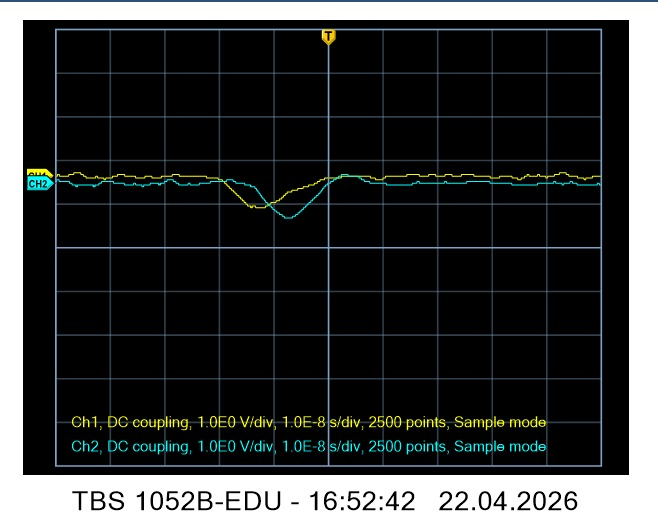

# Early oscilloscope measurements

The four Tektronix TBS 1052B-EDU captures are from 22 April 2026. The screens show DC coupling, 1 V/div on both channels, 10 ns/div and 2,500 points in Sample mode. The native CSV exports record a 10× probe setting. Their voltages are used as exported. The termination, probe or cable connection, PMT control voltage, and trigger settings for this session are unrecorded.

| Scope clock | Original CSV | Screen capture |
| --- | --- | --- |
| 16:52:42 | [Two-channel waveform](raw/tbs1052b-2026-04-22-165242.csv) | [Scope screen](figures/scope-capture-165242.jpg) |
| 16:54:11 | [Two-channel waveform](raw/tbs1052b-2026-04-22-165411.csv) | |
| 16:55:13 | [Two-channel waveform](raw/tbs1052b-2026-04-22-165513.csv) | |
| 16:56:54 | [Two-channel waveform](raw/tbs1052b-2026-04-22-165654.csv) | [Scope screen](figures/scope-capture-165654.jpg) |

## Pulse measurements from the CSVs

The [pulse summary](pulse_summary.csv) uses the median voltage before −30 ns as the baseline. Pulse magnitude is the baseline minus the minimum recorded voltage. The full width at half maximum (FWHM) uses the nearest half-amplitude crossings on either side of the minimum, with linear interpolation between adjacent exported points.

The eight traces in these selected captures have recorded magnitudes of 0.64–1.40 V and FWHM of 8.6–10.2 ns. Those widths describe the displayed waveform. The 50 MHz instrument bandwidth limits pulse-shape fidelity, and the 40 ps spacing between export points comes from interpolation at this time scale. [Tektronix user manual](https://download.tek.com/manual/TBS1000B-User-Manual-077088602-RevA.pdf)

## Processed examples

Two previously processed images illustrate a [dual-channel pulse](figures/processed-event-0.jpg) and a [pulse visible only on CH2](figures/processed-event-3.jpg). These images have separate event identifiers from the Tektronix exports above.

These selected events document the observed negative pulse shapes and channel behavior. A quantitative comparison with the [Geant4 example run](../../simulation/geant4/results/run-2026-11-13/README.md) needs matched geometry, PMT gain, termination, and a model of the acquisition bandwidth.
