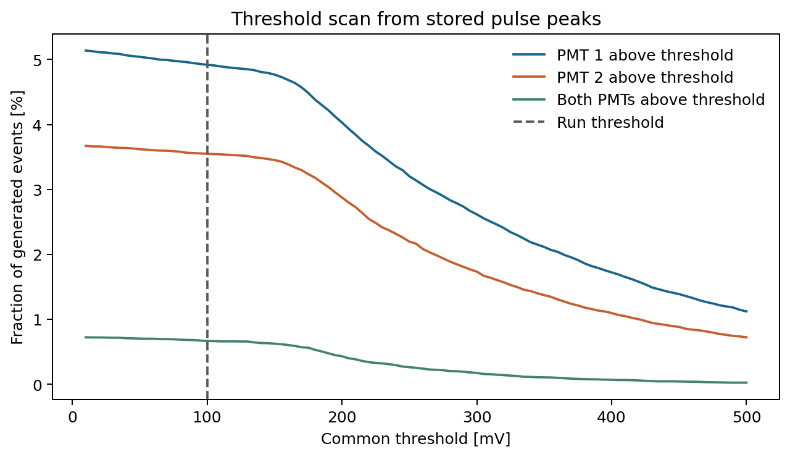

# Example simulation · 50,000 generated muons

This is a Monte Carlo run dated 13 November 2026. The results below come from the recorded terminal summary. The figures were exported by the analysis script. [Download the counting summary](counting_summary.csv).

| Condition | Events | Fraction of generated muons |
| --- | ---: | ---: |
| PMT 1 pulse magnitude at least 100 mV | 2,459 | 4.918% |
| PMT 2 pulse magnitude at least 100 mV | 1,774 | 3.548% |
| Both PMT pulse magnitudes at least 100 mV in the same event | 333 | 0.666% |
| Positive energy deposit in both scintillators | 364 | 0.728% |

The dual-PMT fraction has a 95% Wilson interval of 0.598–0.741%, which reflects Monte Carlo counting uncertainty. The fraction depends on the chosen source plane and angular distribution. The event selection uses two pulse peaks and applies no hardware timing window.

## Run configuration

- 50,000 primary muons split across 12 serial Geant4 processes, using distinct seed pairs.
- Two scintillators with centers 30 cm apart. Primaries are generated on a 60 × 60 cm plane 30 cm above the geometry origin.
- The generator samples zenith angles up to 45° using `sin(theta) cos³(theta)` and kinetic energies from 1 to 100 GeV using an approximate power law proportional to `E^-2.7`.
- H10721-110 response modeled with an approximate R9880U-110 quantum-efficiency curve, a gain of 2 million, a 50 Ω load, a 100 mV pulse-magnitude threshold and 0.1 ns waveform sampling.

## Figures

| Figure | How to read it |
| --- | --- |
| [Threshold scan](figures/threshold_scan.png) | Reapplies each threshold to the same stored pulse peaks. Rates use all generated events as the denominator. |
| [Energy deposit and pulse height](figures/energy_and_pulse_height.png) | Shows positive deposits and nonzero pulse magnitudes. Large pulse heights are predictions of the linear PMT model, which omits saturation. |
| [Optical timing](figures/optical_timing.png) | Compares the shortest photon transport time in each PMT for events with optical hits. The paired difference uses 364 events and describes transport from photon creation to the PMT. |
| [Photons and photoelectrons](figures/photons_and_photoelectrons.png) | Shows the effect of the model's quantum-efficiency sampling in each channel. |
| [Quantum-efficiency input](figures/quantum_efficiency.png) | Shows the approximate wavelength-dependent model input. [Hamamatsu R9880U-110](https://hep.hamamatsu.com/eu/en/products/R9880U-110.html) |
| [Example waveforms](figures/waveform_event_132.png) | Shows one selected event with both pulse peaks above the threshold. |

The PMT model sums photoelectron responses linearly. Pulse heights and threshold acceptance should be compared with oscilloscope measurements at the same gain and termination. The uploaded figures and terminal summary support an internal consistency check. The complete event-level CSV and the exact Geant4 runtime version for this run are unavailable in this snapshot.
